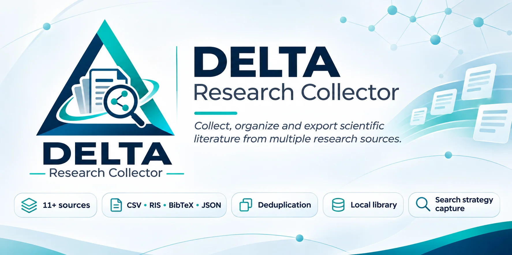
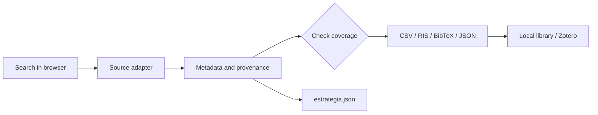

<div align="center">
  

  <h1>DELTA Research Collector</h1>
  <p><strong>From search to bibliography, with context, provenance and transparency.</strong></p>
  <p>An open-source browser extension to collect and organize scholarly metadata.</p>

  <p>
    <a href="https://github.com/miscrapha-DELTA-IA/DELTA-Research-Collector/releases/latest"></a>
    <a href="https://github.com/miscrapha-DELTA-IA/DELTA-Research-Collector/actions/workflows/tests.yml"></a>
    <a href="LICENSE"></a>
    
    
  </p>
  <p>
    <a href="README.md">🇧🇷 Português</a> &nbsp;·&nbsp; <strong>🇺🇸 English</strong> &nbsp;·&nbsp; <a href="README.es.md">🇪🇸 Español</a>
  </p>
  <p>
    <a href="#install-in-2-minutes">Install</a> ·
    <a href="#how-it-works">How it works</a> ·
    <a href="#coverage-by-source">Compatibility</a> ·
    <a href="#reproducibility-and-research-integrity">Research integrity</a> ·
    <a href="#development">Development</a>
  </p>
</div>

> [!IMPORTANT]
> **Experimental project.** DELTA assists with collecting and organizing references, but does not guarantee that exports reproduce a provider's filters, rankings or total results. Verify coverage before reporting counts in scholarly work.

## Why use it?

| Context-aware collection | Interoperable metadata | Traceability | Local library |
|:---:|:---:|:---:|:---:|
| Works on your current search tab | CSV, RIS, BibTeX and JSON | Query, filters and date | Normalized DOI and history |

Designed for researchers switching between discovery platforms who want to **avoid manual copying**, **preserve search context** and **distinguish records actually retrieved from the results displayed by a provider**.

### Key features

- **One-click collection** on supported search pages, with configurable per-run limits.
- **Bibliographic exports:** CSV, RIS (Zotero import), BibTeX and JSON.
- **Search strategy capture:** `*_estrategia.json` with URL, search terms and available parameters.
- **Deduplicated local library** with DOI normalization and run history.
- **Full-text access signals** for confirmed open copies, publisher restrictions and unknown availability.
- **Optional arXiv PDFs:** up to 20 requests per collection, without bypassing access controls.

## Install in 2 minutes

**[Download latest Release](https://github.com/miscrapha-DELTA-IA/DELTA-Research-Collector/releases/latest)** · [Source code](https://github.com/miscrapha-DELTA-IA/DELTA-Research-Collector)

1. Download `DELTA-Research-Collector_v*_INSTALAR.zip` from the Release **Assets** section.
2. Extract it to a permanent folder (do not select the ZIP itself).
3. Open `opera://extensions`, `chrome://extensions` or `edge://extensions`.
4. Enable **Developer mode** and choose **Load unpacked**.
5. Select the folder containing **`manifest.json` at its root**.
6. Open an [arXiv search](https://arxiv.org/search/?query=bioinformatics&searchtype=all&size=50) or [PubMed search](https://pubmed.ncbi.nlm.nih.gov/?term=dengue), then refresh the page.

> **Updating:** to preserve the existing local library, replace the files in your installed extension folder and select **Reload** on the extensions page. Avoid installing duplicate copies.

## How it works



**Typical workflow:** run the search, open DELTA, review the source and captured parameters, choose an export, compare recovered records to the expected result count and store the strategy file alongside the dataset.

<details>
<summary><strong>IEEE Xplore: why does a search with hundreds of hits produce ~25 records?</strong></summary>

Direct IEEE collection reads **visible result cards only**, not every results page. If IEEE reports 512 hits and DELTA recovers about 25, the export is **partial**. For larger datasets, use **IEEE Xplore's native CSV export** and import that file into DELTA. Enter the expected total to compare counts. Matching counts alone do not verify metadata accuracy.
</details>

## Coverage by source

| Source | Integration | Important limitation |
|---|---|---|
| **IEEE Xplore** | Visible cards + native CSV import | Direct collection is partial; no automatic pagination |
| **arXiv** | Paginated results HTML | HTML changes may break extraction |
| **Europe PMC** | Official API | Fields depend on available source records |
| **PubMed** | NCBI ESearch + EFetch | Unsupported sidebar filters are blocked |
| **OpenAlex** | API | Coverage and ranking can differ from the website |
| **Crossref** | API | Metadata and ranking can differ from the website |
| **Semantic Scholar** | Academic Graph API | Rate and result-count limits |
| **DOAJ** | Public API | Complex UI filters may not be reproduced |
| **SciELO** | Experimental HTML extraction | Layout changes and access restrictions |
| **bioRxiv** | Date-range API | Local term filtering is not equivalent to site search |
| **medRxiv** | Date-range API | Local term filtering is not equivalent to site search |

**11 integrations ≠ 11 exhaustive search engines.** Retrieval methods differ, and inclusion in this matrix does not establish systematic-review validation.

## Reproducibility and research integrity

The strategy export helps document how a search was performed:

| Field | Purpose |
|---|---|
| Search query / terms | Preserve detected search expression |
| URL and parameters | Capture filters encoded in the URL |
| Timestamp | Establish when the search occurred |
| Source and method | Distinguish API, HTML, visible page and import |
| Expected / retrieved totals | Surface coverage gaps when the total is known |
| Access status and evidence | Separate confirmed open copies from signals and unknowns |

**Access states:** `open`, `publisher_restricted`, `no_open_copy_found`, `unknown`. **Failure to find an open copy does not prove a paywall.** A full-text link is not a guarantee of download access or reuse rights.

For papers and reviews, retain the source platform's original exports where possible, document exclusions and independently validate the search. See [Scientific methodology](docs/METHODOLOGY.md).

## Local library, privacy and Zotero

The library is stored in `chrome.storage.local`, supports up to **12,000 unique records**, and retains the **80 most recent collection events**. Deduplication uses normalized DOIs, falling back to **source + identifier** where DOI is absent. Preprints and their published versions may have different DOIs and remain separate.

No DELTA account or custom backend is required. **RIS/BibTeX exports can be imported into Zotero** but there is **no direct Zotero account synchronization**. An optional DOI-based open-access lookup calls OpenAlex and shares the queried DOIs with that service.

## Development

```bash
git clone https://github.com/miscrapha-DELTA-IA/DELTA-Research-Collector.git
cd DELTA-Research-Collector
node --check collector-core.js
node --check content.js
node --check background.js
node tests/test-core.cjs
node tests/test-background.cjs
node tests/test-context.cjs
```

Unit tests and syntax checks also run on [GitHub Actions](https://github.com/miscrapha-DELTA-IA/DELTA-Research-Collector/actions/workflows/tests.yml). **Passing offline tests does not validate live integrations.**

<details>
<summary><strong>Architecture overview</strong></summary>

```text
manifest.json                Chromium Manifest V3
content.js                   Page interface and collection
collector-core.js            Adapters, normalization, exports
background.js                Allowlisted network calls, library, downloads
icons/                       Installed extension icons
assets/branding/             Repository visual identity
tests/                       Unit and smoke tests
docs/                        Research methods and architecture
.github/workflows/           CI and packaging
```

See [docs/ARCHITECTURE.md](docs/ARCHITECTURE.md) for details.
</details>

## Roadmap

- [ ] Improve IEEE coverage through authorized, verifiable pagination.
- [ ] Support native CSV/RIS import from more providers.
- [ ] Audit query/filter equivalence and retrieval coverage for each adapter.
- [ ] Improve duplicate/version/provenance inspection.
- [ ] Improve panel UX, accessibility and interface translations.
- [ ] Add controlled Chromium end-to-end tests.

## Community and attribution

Bugs and ideas: [Issues](https://github.com/miscrapha-DELTA-IA/DELTA-Research-Collector/issues) · Contributions: [CONTRIBUTING.md](CONTRIBUTING.md) · Security: [SECURITY.md](SECURITY.md) · History: [CHANGELOG.md](CHANGELOG.md).

A **DELTA IA** initiative, inspired by Koen Raijer's [arxivcollector](https://github.com/koenraijer/arxivcollector). The code is distributed under the terms of [LICENSE](LICENSE). This project is not affiliated with the listed scholarly databases.

<div align="center">
  <sub>Open science is not only about finding results — it is about knowing how they were found.</sub>
</div>