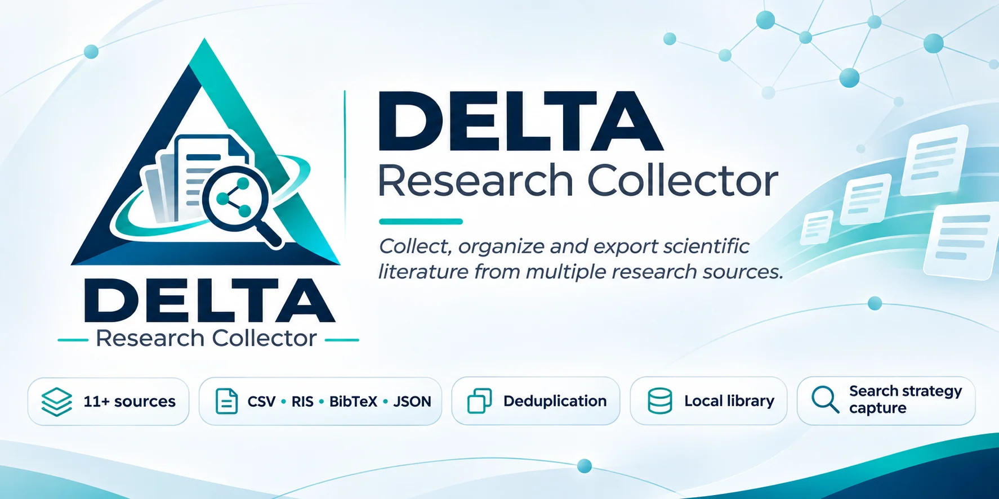
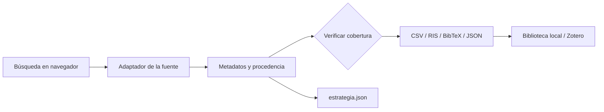

<div align="center">
  

  <h1>DELTA Research Collector</h1>
  <p><strong>De la búsqueda a la bibliografía, con contexto, procedencia y transparencia.</strong></p>
  <p>Extensión de código abierto para recopilar y organizar metadatos científicos desde el navegador.</p>

  <p>
    <a href="https://github.com/miscrapha-DELTA-IA/DELTA-Research-Collector/releases/latest"></a>
    <a href="https://github.com/miscrapha-DELTA-IA/DELTA-Research-Collector/actions/workflows/tests.yml"></a>
    <a href="LICENSE"></a>
    
    
  </p>
  <p>
    <a href="README.md">🇧🇷 Português</a> &nbsp;·&nbsp; <a href="README.en.md">🇺🇸 English</a> &nbsp;·&nbsp; <strong>🇪🇸 Español</strong>
  </p>
  <p>
    <a href="#instalación-en-2-minutos">Instalar</a> ·
    <a href="#cómo-funciona">Cómo funciona</a> ·
    <a href="#cobertura-por-fuente">Compatibilidad</a> ·
    <a href="#reproducibilidad-e-integridad-científica">Integridad científica</a> ·
    <a href="#desarrollo">Desarrollo</a>
  </p>
</div>

**Interfaz v0.5.1:** panel simplificado: consulta, límite, total informado y exportación a primera vista. Importación del IEEE, biblioteca, matriz de revisión y opciones avanzadas en secciones desplegables. Los métodos de recuperación no cambian.

> [!IMPORTANT]
> **Proyecto experimental.** DELTA ayuda a recopilar y organizar referencias, pero no garantiza que una exportación reproduzca completamente los filtros, la clasificación o el total de resultados de cada plataforma. Verifique la cobertura antes de publicar cifras en una investigación.

## ¿Por qué utilizarlo?

| Recopilación contextual | Metadatos interoperables | Trazabilidad | Biblioteca local |
|:---:|:---:|:---:|:---:|
| Funciona en la búsqueda actual | CSV, RIS, BibTeX y JSON | Consulta, filtros y fecha | DOI normalizado e historial |

Diseñado para investigadores que trabajan con varias bases y desean **evitar copiar referencias manualmente**, **preservar el contexto de búsqueda** y **distinguir los registros recuperados de los resultados mostrados**.

### Funciones principales

- **Un botón de recopilación** en páginas compatibles, con límites configurables.
- **Exportación bibliográfica:** CSV, RIS (importable en Zotero), BibTeX y JSON.
- **Registro de estrategia:** `*_estrategia.json` con URL, términos y parámetros disponibles.
- **Biblioteca local deduplicada**, normalización de DOI e historial de operaciones.
- **Indicadores de acceso** a texto completo: copia abierta, restricción editorial o disponibilidad desconocida.
- **PDF de arXiv opcionales:** hasta 20 solicitudes por operación, sin eludir controles de acceso.

## Instalación en 2 minutos

**[Descargar la última Release](https://github.com/miscrapha-DELTA-IA/DELTA-Research-Collector/releases/latest)** · [Código fuente](https://github.com/miscrapha-DELTA-IA/DELTA-Research-Collector)

1. Descargue `DELTA-Research-Collector_v*_INSTALAR.zip` en **Assets** de la Release.
2. Extraiga el ZIP a una carpeta permanente.
3. Abra `opera://extensions`, `chrome://extensions` o `edge://extensions`.
4. Active **Modo de desarrollador** y seleccione **Cargar descomprimida / Load unpacked**.
5. Seleccione la carpeta que contiene **`manifest.json` en la raíz**.
6. Abra una búsqueda en [arXiv](https://arxiv.org/search/?query=bioinformatics&searchtype=all&size=50) o [PubMed](https://pubmed.ncbi.nlm.nih.gov/?term=dengue) y actualice la página.

> **Actualización:** para conservar la biblioteca local existente, reemplace los archivos en la misma carpeta de instalación y pulse **Recargar** en la página de extensiones. Evite instalar duplicados.

## Cómo funciona



**Flujo recomendado:** ejecute la búsqueda, abra DELTA, compruebe la fuente y sus parámetros, seleccione el formato, compare los registros recuperados con el total esperado y guarde el archivo de estrategia junto a los resultados.

<details>
<summary><strong>IEEE Xplore: ¿por qué una búsqueda con cientos de resultados genera ~25 registros?</strong></summary>

La recopilación directa del IEEE lee **solo los resultados visibles de la página actual**. Si IEEE informa 512 resultados y DELTA obtiene unos 25, la exportación es **parcial**. Para conjuntos grandes, use la **exportación CSV nativa de IEEE Xplore** e importe el archivo en DELTA. Indique el total esperado para comparar las cantidades. La coincidencia numérica no demuestra por sí misma la exactitud de los metadatos.
</details>

## Matriz visual de cribado — nueva en v0.5.0

Además de CSV, RIS, BibTeX y JSON, la extensión ahora exporta una **matriz interactiva en HTML que funciona sin conexión**, pensada para el cribado manual de colecciones extensas.

- **Lectura clara:** títulos destacados, resúmenes desplegables, autores, año, DOI y enlaces.
- **Filtros de revisión:** búsqueda libre, fuente, acceso, decisión y metadatos ausentes.
- **Decisiones documentadas:** **Incluir / Excluir / Duda / Pendiente**, con motivos y notas.
- **Anotaciones portátiles:** exportar CSV anotado o guardar e importar decisiones JSON.
- **Auditoría de cobertura:** totales recuperados, total informado y advertencias metodológicas.

**Uso:** realiza una búsqueda, introduce opcionalmente el total mostrado por la base en *Auditoria de cobertura*, selecciona **Matriz visual interativa (HTML)** y abre el archivo descargado. También puedes exportar la biblioteca local como matriz visual.

> **Advertencia:** la coincidencia de cantidades no demuestra equivalencia de registros, filtros ni ordenación. Exporta tus decisiones antes de cerrar el archivo.

[Guía completa y limitaciones metodológicas](docs/REVIEW_MATRIX.md)

## Cobertura por fuente

| Fuente | Integración | Limitación relevante |
|---|---|---|
| **IEEE Xplore** | Tarjetas visibles + importación CSV | Recopilación directa parcial; sin paginación automática |
| **arXiv** | HTML paginado | Cambios de HTML pueden afectar la extracción |
| **Europe PMC** | API oficial | Campos sujetos a disponibilidad |
| **PubMed** | NCBI ESearch + EFetch | Bloquea filtros laterales no compatibles |
| **OpenAlex** | API | Cobertura y ranking pueden diferir del sitio |
| **Crossref** | API | Metadatos y orden pueden diferir |
| **Semantic Scholar** | Academic Graph API | Límites de solicitudes y resultados |
| **DOAJ** | API pública | Filtros complejos pueden no reproducirse |
| **SciELO** | Extracción HTML experimental | Cambios de diseño y restricciones de acceso |
| **bioRxiv** | API por fechas | El filtro textual local no equivale a la búsqueda del sitio |
| **medRxiv** | API por fechas | El filtro textual local no equivale a la búsqueda del sitio |

**11 integraciones no equivalen a 11 búsquedas exhaustivas.** Los métodos de recuperación varían; aparecer en la tabla no significa validación para revisiones sistemáticas.

## Reproducibilidad e integridad científica

El archivo de estrategia ayuda a documentar la búsqueda:

| Campo | Finalidad |
|---|---|
| Expresión / términos | Registrar la consulta detectada |
| URL y parámetros | Conservar los filtros codificados en la URL |
| Fecha y hora | Establecer el momento de la búsqueda |
| Fuente y método | Diferenciar API, HTML, página visible e importación |
| Total esperado / recuperado | Identificar brechas de cobertura si se conoce el total |
| Estado de acceso y evidencia | Separar copias abiertas confirmadas de señales e incógnitas |

**Estados de acceso:** `open`, `publisher_restricted`, `no_open_copy_found`, `unknown`. **No encontrar una copia abierta no prueba que exista un muro de pago.** Un enlace no garantiza el derecho de descargar o reutilizar el artículo.

Para revisiones, conserve las exportaciones originales de la plataforma, documente exclusiones y verifique la estrategia de forma independiente. Consulte [Metodología científica](docs/METHODOLOGY.md).

## Biblioteca local, privacidad y Zotero

Se utiliza `chrome.storage.local`, con hasta **12.000 registros únicos** y las **80 operaciones** más recientes. La deduplicación utiliza DOI normalizado o, si falta, **fuente + identificador**. Un preprint y su publicación final pueden conservarse como registros separados.

No se requiere cuenta DELTA ni servidor propio. Los archivos **RIS/BibTeX pueden importarse en Zotero**, pero **no existe sincronización directa** con una cuenta. La consulta opcional de acceso abierto por DOI utiliza OpenAlex y transmite los DOI consultados.

## Desarrollo

```bash
git clone https://github.com/miscrapha-DELTA-IA/DELTA-Research-Collector.git
cd DELTA-Research-Collector
node --check collector-core.js
node --check content.js
node --check background.js
node tests/test-core.cjs
node tests/test-background.cjs
node tests/test-context.cjs
```

Las pruebas locales también se ejecutan en [GitHub Actions](https://github.com/miscrapha-DELTA-IA/DELTA-Research-Collector/actions/workflows/tests.yml). **No sustituyen pruebas de integración en vivo.**

<details>
<summary><strong>Arquitectura resumida</strong></summary>

```text
manifest.json                Chromium Manifest V3
content.js                   Interfaz y recopilación en la página
collector-core.js            Adaptadores y exportación
background.js                Solicitudes autorizadas, biblioteca, descargas
icons/                       Iconos de la extensión
assets/branding/             Identidad visual del repositorio
tests/                       Pruebas unitarias
docs/                        Documentación científica y técnica
.github/workflows/           CI y empaquetado
```

Más información en [docs/ARCHITECTURE.md](docs/ARCHITECTURE.md).
</details>

## Hoja de ruta

- [ ] Mejorar la cobertura del IEEE mediante paginación autorizada y verificable.
- [ ] Importar CSV/RIS nativos de más plataformas.
- [ ] Auditar equivalencia de filtros y cobertura por fuente.
- [ ] Mejorar la inspección de duplicados, versiones y procedencia.
- [ ] Mejorar UX, accesibilidad y traducciones de la interfaz.
- [ ] Añadir pruebas end-to-end controladas en Chromium.

## Comunidad y atribución

Errores y sugerencias: [Issues](https://github.com/miscrapha-DELTA-IA/DELTA-Research-Collector/issues) · Contribuciones: [CONTRIBUTING.md](CONTRIBUTING.md) · Seguridad: [SECURITY.md](SECURITY.md) · Cambios: [CHANGELOG.md](CHANGELOG.md).

Una iniciativa de **DELTA IA**, inspirada en [arxivcollector](https://github.com/koenraijer/arxivcollector), de Koen Raijer. Consulte [LICENSE](LICENSE) para los términos de distribución. El proyecto no está afiliado oficialmente con las bases mencionadas.

<div align="center">
  <sub>La ciencia abierta no consiste solo en encontrar resultados, sino también en saber cómo se encontraron.</sub>
</div>