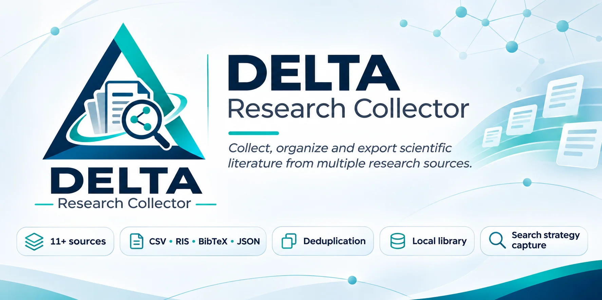
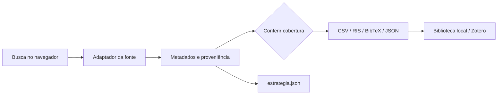

<div align="center">
  

  <h1>DELTA Research Collector</h1>
  <p><strong>Da busca à bibliografia, com contexto, proveniência e transparência.</strong></p>
  <p>Extensão open-source para coletar e organizar metadados científicos diretamente do navegador.</p>

  <p>
    <a href="https://github.com/miscrapha-DELTA-IA/DELTA-Research-Collector/releases/latest"></a>
    <a href="https://github.com/miscrapha-DELTA-IA/DELTA-Research-Collector/actions/workflows/tests.yml"></a>
    <a href="LICENSE"></a>
    
    
  </p>
  <p>
    <strong>🇧🇷 Português</strong> &nbsp;·&nbsp; <a href="README.en.md">🇺🇸 English</a> &nbsp;·&nbsp; <a href="README.es.md">🇪🇸 Español</a>
  </p>
  <p>
    <a href="#instalação-em-2-minutos">Instalar</a> ·
    <a href="#como-funciona">Como funciona</a> ·
    <a href="#cobertura-por-base">Compatibilidade</a> ·
    <a href="#reprodutibilidade-e-integridade-científica">Integridade científica</a> ·
    <a href="#desenvolvimento">Desenvolvimento</a>
  </p>
</div>

**Interface v0.5.1:** painel de coleta simplificado. A busca, os limites, o total informado e a exportação ficam em primeiro plano. Importação IEEE, matriz visual, biblioteca e ajustes técnicos aparecem em seções expansíveis. A coleta permanece experimental.

> [!IMPORTANT]
> **Projeto experimental.** O DELTA auxilia a coleta e a organização bibliográfica, mas não assegura que uma exportação reproduza integralmente os filtros, a ordenação ou o número de resultados exibido por cada base. Confirme a cobertura antes de reportar números em um estudo científico.

## Por que usar?

| Coleta contextual | Metadados interoperáveis | Rastreabilidade | Biblioteca local |
|:---:|:---:|:---:|:---:|
| Abre na aba de pesquisa atual | CSV, RIS, BibTeX e JSON | String de busca, filtros e data | DOI normalizado e histórico |

O fluxo foi criado para quem alterna entre diferentes mecanismos de descoberta de literatura e precisa **evitar copiar referências manualmente**, **manter a estratégia de busca** e **distinguir resultados recuperados de resultados apenas encontrados**.

## Cross-Reference Engine v0.6.0 — verificação bibliográfica transversal

A mesma etapa de verificação por DOI é oferecida para todas as fontes do DELTA, incluindo coleta CAPES, PubMed, SciELO, arXiv e importações oficiais. Depois da coleta, o DELTA consulta o DOI exato no **Crossref**, com tentativa de **DataCite** quando não existir no primeiro registrador. A opção fica marcada por padrão no painel, com indicação clara de que envia DOIs a serviços externos. Desmarque-a para manter a coleta completamente local nessa etapa.

**Integridade:** preserva os metadados de origem em `xref.original`; somente campos originalmente vazios podem ser preenchidos após comparação rigorosa do DOI, título, ano e autoria. Campos divergentes não são substituídos. A verificação **não** insere nem exclui artigos da busca, nem comprova fidelidade de todos os metadados. Registros sem DOI ou fora do limite permanecem explicitamente não verificados.

**Primeiro lote conservador:** até **30 DOIs únicos** por operação, com controle de concorrência. A auditoria registra `xref_summary`; CSV/JSON incluem a origem e evidência por campo. `registry_match` representa correspondência com **um** registrador, não confirmação por duas fontes independentes. Resumos não são copiados automaticamente por restrições potenciais de direitos autorais.

[Política, estados de verificação, evidências e roadmap técnico](docs/CROSS_REFERENCE.md)

### Principais recursos

- **Um botão de coleta** nas páginas compatíveis, com limites configuráveis por operação.
- **Exportação bibliográfica** em CSV, RIS (importável no Zotero), BibTeX e JSON.
- **Registro de estratégia** em `*_estrategia.json` com URL, termos e parâmetros recuperáveis.
- **Cross-reference por DOI (v0.6.0):** consulta opcional de metadados em registradores e proveniência por campo, mantendo o original preservado.
- **Biblioteca consolidada no navegador**, com deduplicação por DOI e histórico de operações.
- **Sinais de acesso ao texto completo**, incluindo cópia aberta identificada, restrição da editora ou status desconhecido.
- **PDFs do arXiv**, até 20 solicitações opcionais por coleta, sem contornar controles de acesso.

## Instalação em 2 minutos

**[Baixar a última Release](https://github.com/miscrapha-DELTA-IA/DELTA-Research-Collector/releases/latest)** · [Código-fonte](https://github.com/miscrapha-DELTA-IA/DELTA-Research-Collector)

1. Baixe `DELTA-Research-Collector_v*_INSTALAR.zip` em **Assets** da Release.
2. Extraia o ZIP numa pasta permanente (não selecione o ZIP diretamente).
3. Abra `opera://extensions`, `chrome://extensions` ou `edge://extensions`.
4. Ative **Modo do desenvolvedor** e escolha **Carregar sem compactação / Load unpacked**.
5. Selecione a pasta que contém o arquivo **`manifest.json` na raiz**.
6. Abra uma busca no [arXiv](https://arxiv.org/search/?query=bioinformatics&searchtype=all&size=50) ou no [PubMed](https://pubmed.ncbi.nlm.nih.gov/?term=dengue) e atualize a página.

> **Atualização:** para preservar a biblioteca local da extensão já instalada, substitua os arquivos na mesma pasta de instalação e clique em **Recarregar** em `opera://extensions`. Evite instalar duas cópias simultâneas.

## Como funciona



**Exemplo de uso:** execute sua busca, abra o painel do DELTA, confira fonte e parâmetros, selecione a exportação, compare a quantidade recuperada com a quantidade esperada e guarde o arquivo de estratégia junto aos resultados.

<details>
<summary><strong>IEEE Xplore: por que às vezes vêm somente ~25 registros?</strong></summary>

A coleta direta do IEEE é baseada nos **cartões visíveis na página**, não nos resultados de todas as páginas. Se o IEEE mostrar 512 resultados e a extensão recuperar aproximadamente 25, a coleta é **parcial**. Para grandes conjuntos, utilize a exportação **CSV nativa do IEEE Xplore** e importe esse arquivo no painel do DELTA. Informe o total esperado para conferir a contagem. A correspondência numérica, por si só, não valida a exatidão de todos os metadados.
</details>

## Matriz visual de revisão — nova na v0.5.0

Além de CSV, RIS, BibTeX e JSON, a extensão agora exporta uma **matriz interativa em HTML que funciona offline**. Ela foi criada para triagem manual de muitos artigos sem percorrer uma planilha extensa e difícil de ler.

- **Leitura legível:** títulos destacados, resumos expansíveis, autoria, ano, DOI e links para o artigo.
- **Filtros úteis:** texto livre, fonte, evidência de acesso, decisão, ausência de DOI ou resumo.
- **Triagem documentada:** marcar **Incluir / Excluir / Dúvida / Pendente** e registrar motivos e notas.
- **Reutilização:** exportar o CSV anotado ou salvar/reimportar as decisões em JSON.
- **Auditoria visível:** contagens, cobertura e avisos sobre filtros ou coleta parcial.

**Como usar:** abra a busca, informe (se souber) o total exibido pela base no campo *Auditoria de cobertura*, selecione **Matriz visual interativa (HTML)** e faça a coleta. Abra o HTML baixado no navegador. Para exportar uma biblioteca já acumulada, use **Biblioteca → Matriz visual**.

> **Nota:** a concordância de totais não comprova identidade dos registros nem reprodução de filtros e ranking. O relatório é local e não envia suas decisões para serviços DELTA. **Exporte as anotações antes de fechar o arquivo.**

[Fluxo detalhado, interpretações e limitações](docs/REVIEW_MATRIX.md)

## Portal de Periódicos CAPES — coleta por navegação de páginas (experimental, v0.5.9)

**Fluxo principal:** abra uma busca por assunto no Portal CAPES e clique em **Coletar busca**. O DELTA tenta ler os cartões de resultados visíveis, avançar pela paginação disponível na interface e reunir os registros até o limite selecionado (500 por padrão no Portal). A exportação pode ser CSV, RIS, BibTeX, JSON ou matriz de triagem HTML. A biblioteca local e a auditoria são opcionais.

Exemplo de auditoria: **456 resultados exibidos** no Portal não significam 456 registros recuperados. O DELTA registra separadamente total informado, quantidade de registros únicos extraídos, origem, método e eventuais falhas de paginação. Ao faltar resultados, a saída deve ser rotulada como **parcial**. Contagens iguais não confirmam identidade dos registros, filtros e ranking.

**Limites importantes desta fase:**

- A coleta automática é **experimental**, usa a página que o navegador já apresenta e seus controles de paginação. Não há API pública do Portal confirmada nem acesso privilegiado a bases/editoras.
- A estrutura da interface CAPES atual não pôde ser testada externamente (acesso HTTP 403 ao HTML de busca). **Ainda não há confirmação de coleta completa de 456/456 no Opera.** Requer teste E2E com uma sessão de busca real.
- Se a página usar paginação incompatível, recarregar fora do contexto do coletor ou não expuser campos como autores/resumo, o DELTA deve reportar a limitação. Não completa metadados inventados nem ignora páginas silenciosamente.
- Em caso de falha, use **Diagnóstico da página CAPES** para gerar um JSON com seletores e elementos visíveis (confira seu conteúdo antes de compartilhar). Esse diagnóstico não copia cookies ou senhas.
- A alternativa de **importar RIS/BibTeX oficial** continua disponível. Tipos Unicode como `@Revisão` foram corrigidos na v0.5.5.
- A pesquisa pode ser realizada com seu acesso institucional normal (CAFe, IP ou VPN). A extensão não solicita credenciais, não contorna paywalls nem baixa texto completo protegido.

**Correção v0.5.7:** um diagnóstico da busca real identificou 100 cartões `.result-busca` na primeira página e uma paginação `.br-pagination` com total de 456 itens. O adaptador agora reconhece esses componentes, extrai títulos por elementos internos, identifica o total exibido e tenta seguir as setas sem rótulo. O diagnóstico passou a observar apenas cartões bibliográficos e paginação, sem coletar elementos do cabeçalho institucional. **A recuperação de 456/456 ainda depende de teste real no navegador.**

**Correção v0.5.8 — retomar da primeira página:** o DELTA agora inicia a coleta pela **página 1**, mesmo quando o usuário abre a busca na última página. A extensão percorre as páginas **na aba atual** usando os parâmetros nativos `page=` e `num=`, mantém a pesquisa e filtros e armazena o progresso apenas na memória de sessão da extensão (`chrome.storage.session`), separada por aba. Ao completar ou interromper, gera um arquivo de estratégia com as páginas efetivamente recuperadas, total relatado, quantidade única e avisos sobre páginas ou campos faltantes.

**Exemplo de auditoria real:** um CSV da v0.5.7 foi gerado na **página 4**, `num=30`, com filtro `publishyear=2019:2026`: o Portal exibiu **118 resultados** e o DELTA exportou **28**, exatamente a quantidade esperada da última página (91–118). Isso não é uma busca de 456 resultados: esse número pertence à consulta anterior, com outro conjunto de filtros. A v0.5.8 tenta percorrer as **quatro páginas da busca filtrada** (ou cinco páginas com 100 itens na busca sem esse filtro, se os parâmetros e o total forem confirmados).

**Metadados incompletos:** no CSV de teste, título, DOI, ano e link estavam preenchidos, porém **resumo, data e periódico estavam vazios**, e a autoria pode representar somente parte dos autores. A paginação corrigida não resolve automaticamente a ausência de campos; esses dados precisam de validação específica antes de uso científico.

**Validação:** o fluxo de navegação por URL e retomada foi coberto por testes sintéticos, mas **a coleta integral no Opera ainda não está comprovada**. Se a página não avançar, recusar navegação, mudar os filtros ou deixar de apresentar cartões reconhecíveis, o DELTA exportará apenas os registros recuperados e identificará o resultado como parcial. Fechar a aba ou reiniciar o navegador pode interromper a coleta.

**Auditoria v0.5.9:** novo CSV da busca temporalmente filtrada contém **118 identificadores e 118 títulos distintos**, correspondentes ao total apresentado pelo Portal, mas ainda sem comprovação externa de identidade de cada registro. A inspeção encontrou anos incorretos extraídos de trechos de resultados, autoria incompleta, resumos/periódicos vazios e pelo menos um DOI concatenado com texto de navegação.

A extração foi endurecida para obter o ano da linha de publicação do cartão, reconhecer o periódico após a barra `|`, reunir todos os links de autores visíveis, priorizar links DOI e rejeitar sufixos textuais suspeitos. Trechos de resultados **não** são tratados como resumos completos. O relatório de estratégia agora registra contagens de campos ausentes.

**Proteção contra HTML desatualizado:** a CAPES pode exibir cartões da última página enquanto a URL já indica `page=1`. A v0.5.9 valida a faixa efetiva mostrada pela paginação (por exemplo, `91–118 de 118`) antes de atribuir artigos a uma página. Em caso de divergência persistente, a coleta para e sinaliza saída parcial, em vez de declarar cobertura completa por engano.

**Independente e não homologada pela CAPES.** Preserve a URL, os parâmetros e o relatório de cobertura e confira uma amostra contra os resultados originais antes de usar os dados em estudo científico.

## Cobertura por base

| Fonte | Estratégia de integração | Limitação a observar |
|---|---|---|
| **Portal CAPES** | Coleta experimental dos cartões/páginas do navegador; RIS/BibTeX oficial alternativo | Paginação e completude não validadas em sessão real; pode haver metadados ausentes |
| **IEEE Xplore** | Cartões visíveis e importação de CSV nativo | Coleta direta parcial; não pagina automaticamente |
| **arXiv** | Resultados HTML paginados | Alterações no HTML podem afetar a coleta |
| **Europe PMC** | API oficial | Campos dependem dos registros disponíveis |
| **PubMed** | NCBI ESearch + EFetch | Filtros laterais não traduzíveis são bloqueados |
| **OpenAlex** | API | Cobertura e ranking podem divergir do site |
| **Crossref** | API | Metadados e ordenação podem divergir da interface |
| **Semantic Scholar** | API Academic Graph | Limites de requisição e de quantidade |
| **DOAJ** | API pública | Filtros complexos da interface podem não ser reproduzidos |
| **SciELO** | Extração HTML experimental | Mudanças de layout e restrições de acesso |
| **bioRxiv** | API por intervalo de datas | Filtro textual local não equivale à busca do site |
| **medRxiv** | API por intervalo de datas | Filtro textual local não equivale à busca do site |

**11 adaptadores anteriores + coleta experimental CAPES não equivalem a buscas exaustivas.** As estratégias de extração diferem; nenhuma base deve ser considerada validada para revisão sistemática apenas pela presença nesta tabela.

## Reprodutibilidade e integridade científica

A exportação de estratégia ajuda a registrar os passos da pesquisa:

| Campo | Finalidade |
|---|---|
| `search_query` / expressão | Registrar os termos detectados |
| URL e parâmetros | Preservar filtros codificados no endereço |
| Data/hora | Situar temporalmente a consulta |
| Fonte e método | Diferenciar API, HTML, página visível e importação |
| Total esperado / recuperado | Identificar lacunas de cobertura quando conhecido |
| Status de acesso e evidência | Separar acesso aberto confirmado de indícios e desconhecimento |

**Estados de acesso:** `open`, `publisher_restricted`, `no_open_copy_found`, `unknown`. **Não encontrar uma cópia aberta não comprova paywall.** Links para texto completo não garantem download ou permissão de reutilização.

Para relatar resultados em artigos e revisões, preserve também o CSV original da plataforma, documente exclusões e faça conferência independente. Consulte [Metodologia](docs/METHODOLOGY.md).

## Biblioteca local, privacidade e Zotero

A biblioteca usa `chrome.storage.local`, admite até **12.000 registros únicos** e mantém as **80 operações** mais recentes. A deduplicação procura o DOI normalizado; sem DOI, usa **fonte + identificador**. Preprints e artigos publicados com DOIs distintos podem permanecer separados.

A extensão não exige conta DELTA ou backend próprio. A exportação **RIS/BibTeX permite importar** registros no Zotero, mas **não implementa sincronização direta** com a conta. Uma consulta opcional de acesso aberto por DOI utiliza a API OpenAlex, que recebe esses DOIs.

## Desenvolvimento

```bash
git clone https://github.com/miscrapha-DELTA-IA/DELTA-Research-Collector.git
cd DELTA-Research-Collector
node --check collector-core.js
node --check content.js
node --check background.js
node tests/test-core.cjs
node tests/test-background.cjs
node tests/test-context.cjs
```

Os testes unitários e a verificação de sintaxe rodam também pelo [GitHub Actions](https://github.com/miscrapha-DELTA-IA/DELTA-Research-Collector/actions/workflows/tests.yml). **Eles não substituem testes ao vivo nos sites das bases.**

<details>
<summary><strong>Arquitetura resumida</strong></summary>

```text
manifest.json                Chromium Manifest V3
content.js                   Interface e coleta na página
collector-core.js            Adaptadores, normalização, exportação
background.js                Requisições permitidas, biblioteca, downloads
icons/                       Ícones da extensão instalada
assets/branding/             Identidade visual do repositório
tests/                       Testes unitários e verificações
docs/                        Metodologia e arquitetura
.github/workflows/           CI e empacotamento
```

Mais detalhes em [docs/ARCHITECTURE.md](docs/ARCHITECTURE.md).
</details>

## Roadmap

- [ ] Melhorar coleta com paginação verificável no IEEE por métodos autorizados.
- [ ] Suporte mais amplo a importações CSV/RIS nativas das bases.
- [ ] Auditorias de equivalência de filtros e de cobertura por conector.
- [ ] Visualização consolidada de duplicatas, versões e proveniência.
- [ ] UX e acessibilidade do painel; tradução da interface.
- [ ] Testes end-to-end controlados em navegadores Chromium.

## Comunidade e atribuição

Bugs e sugestões: [Issues](https://github.com/miscrapha-DELTA-IA/DELTA-Research-Collector/issues) · Como contribuir: [CONTRIBUTING.md](CONTRIBUTING.md) · Segurança: [SECURITY.md](SECURITY.md) · Histórico: [CHANGELOG.md](CHANGELOG.md).

Iniciativa do ecossistema **DELTA IA**, inspirada pelo projeto [arxivcollector](https://github.com/koenraijer/arxivcollector) de Koen Raijer. Código distribuído sob os termos indicados no arquivo [LICENSE](LICENSE). Não há afiliação oficial com as bases listadas.

<div align="center">
  <sub>Ciência aberta exige não apenas encontrar resultados, mas saber como eles foram encontrados.</sub>
</div>